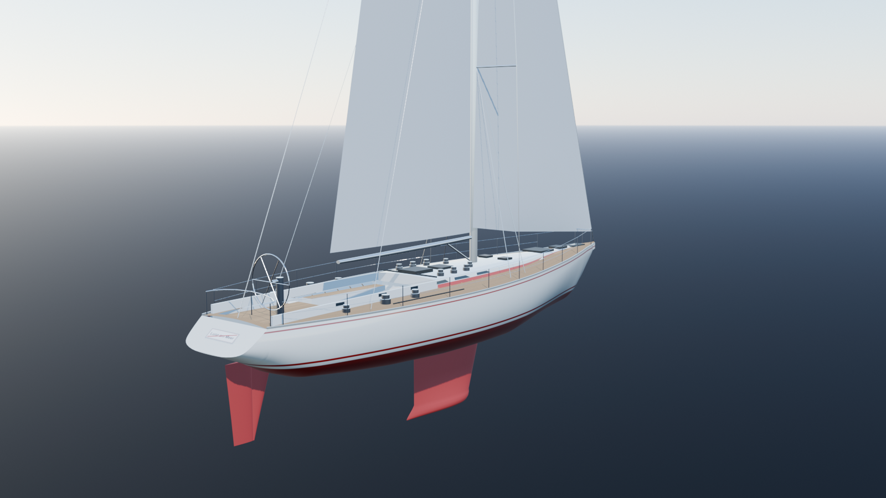
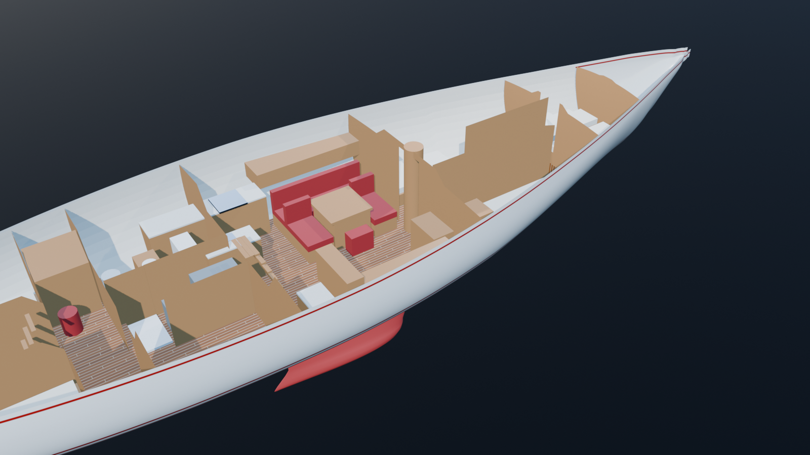
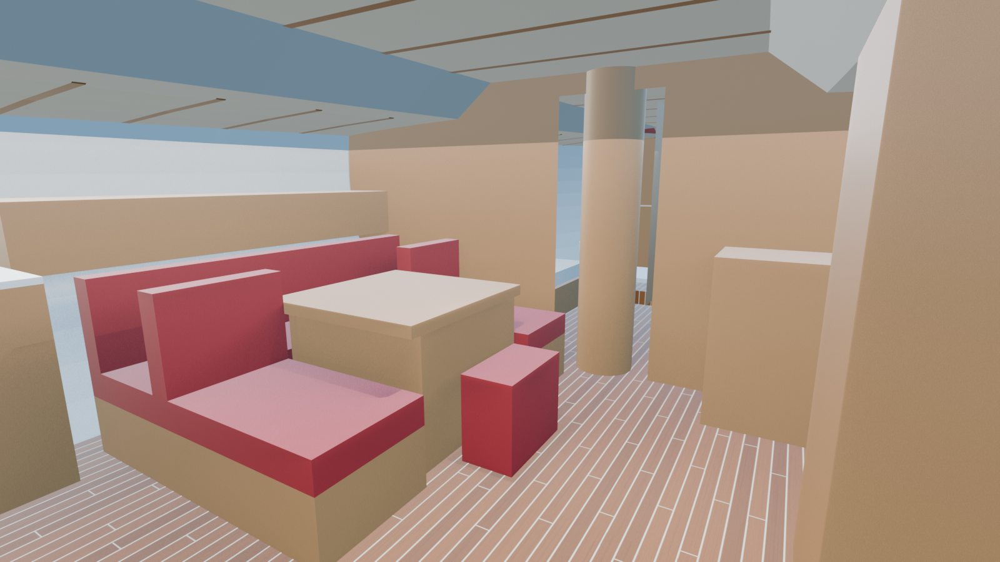
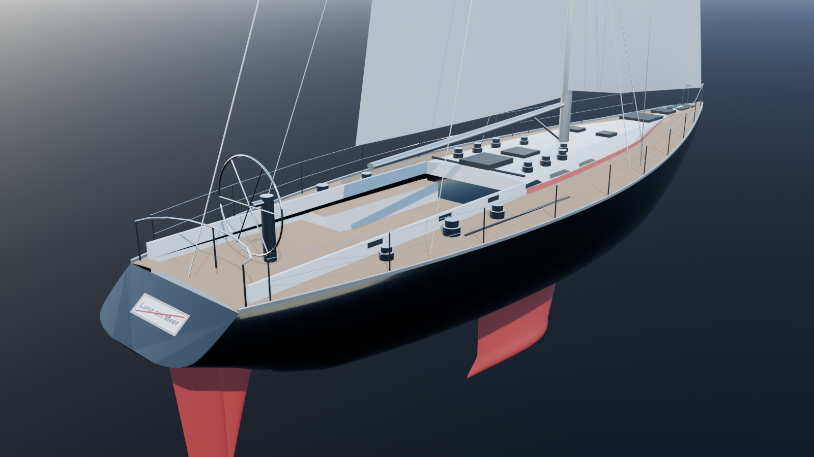
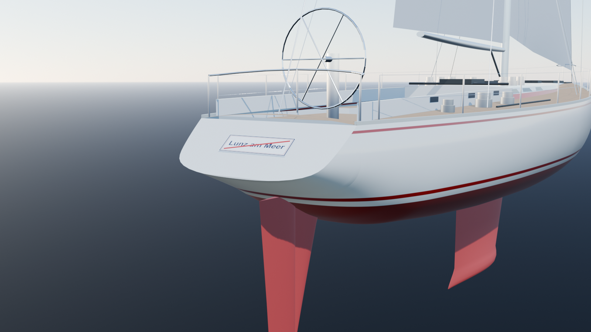

# Swan 651, museo web 3D



Un museo web dedicato allo Swan 651, la barca a vela di 65 piedi (circa 20 metri) disegnata da Germán Frers e costruito da Nautor's Swan fra il 1982 e il 1991. Il visitatore scorre una pagina che racconta la barca attraverso un modello 3D interattivo: dalla tavola di progetto agli esterni, dagli interni alla navigazione in mare aperto.

> **Progetto personale e non ufficiale.** Non è affiliato, sponsorizzato né approvato da Nautor's Swan o da Oy Nautor Ab. "Nautor's Swan" e "Swan" sono marchi dei rispettivi titolari e sono citati solo per descrivere la barca a cui il progetto è dedicato.

## Come è fatto

Il progetto segue una pipeline in tre passi, tutta definita in codice:

```
scripts/blender/  ->  models/  ->  web/
 (script Python)     (GLB, FBX)    (sito three.js)
```

1. **Modello da script.** Lo scafo, l'armo, l'attrezzatura di coperta e gli interni sono generati interamente da script Python per Blender (`scripts/blender/`), senza modellazione a mano né generazione AI. Le forme partono dalla tavola di profilo dello scafo e dai dati di stazza riassunti in `reference/swan651-data.json`.
2. **Esportazione.** `build_and_export.py` ricostruisce la scena, esporta `models/swan651.glb` e `models/swan651.fbx`, salva il `.blend` e lancia l'ottimizzazione del GLB per il web (istanze GPU, quantizzazione, meshopt, texture KTX2).
3. **Sito.** La cartella `web/` carica il modello ottimizzato e lo mette in scena.

```bash
/Applications/Blender.app/Contents/MacOS/Blender -b models/swan651.blend \
  --python scripts/blender/build_and_export.py
```

## Il sito

Il sito ha due ingressi:

- **`/`, la landing a scroll.** Una pagina divisa in 18 passi e quattro capitoli (Blueprint, Esterni, Interni, Navigazione). Ogni passo ha un fotogramma chiave per camera, taglio dello scafo, vele, mare e grading; la pagina interpola fra un passo e l'altro. Nel capitolo Navigazione la barca è in mare aperto, con onde FFT calcolate sulla GPU, atmosfera e nuvole volumetriche, coste ricostruite da dati altimetrici reali e una modalità in cui si governa la barca.
- **`/bordo/`, il "computer di bordo".** Una visita guidata a voce: un agente vocale ascolta le domande del visitatore, risponde e muove la camera sulle scene del museo, aprendo foto e grafici quando servono.

### Stack

| Parte | Tecnologie |
|---|---|
| Rendering 3D | [three.js](https://threejs.org) r186, [postprocessing](https://github.com/pmndrs/postprocessing), [N8AO](https://github.com/N8python/n8ao) |
| Cielo e atmosfera | [@takram/three-atmosphere](https://github.com/takram-design-engineering/three-geospatial) e @takram/three-clouds |
| Scroll e grafici | [Lenis](https://lenis.darkroom.engineering), d3-geo, d3-shape, topojson |
| Build | [Vite](https://vite.dev) 8, pnpm 11 |
| Ottimizzazione modello | glTF Transform, meshoptimizer, KTX2 (Basis Universal) |
| Hosting | Cloudflare Workers (sito statico più la route `/token`) |
| Agente vocale (`agent/`) | Python 3.13, [LiveKit Agents](https://docs.livekit.io/agents/), Claude (Anthropic), Deepgram, ElevenLabs |

### Avviare il sito in locale

Servono Node.js e pnpm 11.

```bash
cd web
pnpm install
pnpm run dev
```

La landing si apre su <http://localhost:5173/>. Alcuni parametri utili:

- `?step=N` apre direttamente il passo N;
- `?seed=N` fissa ora del giorno, vento e costa (per esempio `2` tramonto, `89` pioggia);
- `?cielo=alta|media|bassa|spenta` sceglie la qualità delle nuvole.

Altri comandi in `web/`:

| Comando | Cosa fa |
|---|---|
| `pnpm run build` | Build di produzione in `web/dist/` |
| `pnpm run preview` | Serve la build di produzione |
| `pnpm run modello` | Ottimizza il GLB di `models/` per il web |
| `pnpm run modello:stat` | Peso, triangoli e memoria texture del modello grezzo e di quello ottimizzato |

La pagina `/bordo/` ha bisogno anche dell'agente vocale, di un server LiveKit e delle chiavi API (Anthropic, Deepgram, ElevenLabs): le variabili sono in [`agent/.env.example`](agent/.env.example).

Materiale non incluso nella repo: le foto di riferimento, la tavola Nautor usata dagli script dello scafo e le foto di regata mostrate dal computer di bordo (`web/public/img/bordo/`) appartengono ai rispettivi autori e restano fuori da git. Senza di esse il sito funziona, ma il computer di bordo non mostra le foto e gli script che leggono la tavola (`extract_outlines.py`, `measure_drawing.py`) non si possono rieseguire; i contorni già estratti sono in `reference/drawing_outlines_px.json`.

## Struttura della repo

| Cartella | Contenuto |
|---|---|
| `scripts/blender/` | Script che generano scafo, armo, interni, spinnaker e gennaker, gabbiani, ed esportano il modello |
| `scripts/` | Utilità di supporto: misure dalle tavole, texture del legno e delle vele, terreni costieri (`scripts/terrain/`) |
| `models/` | Modello generato: `swan651.glb`, `swan651.fbx`, `swan651.blend` e texture |
| `web/` | Il sito: landing, pagina `/bordo/`, Worker Cloudflare e script per il modello |
| `agent/` | Il computer di bordo: agente vocale in Python, prompt, base di conoscenza e server dei token |
| `reference/` | Dati tecnici della barca e contorni dello scafo estratti dalla tavola |
| `renders/` | Render del modello nelle sue versioni successive |

## Galleria

| | |
|---|---|
|  |  |
| Spaccato degli interni | Dinette |
|  |  |
| Pozzetto | Poppa |

## Stato del progetto

È una demo in sviluppo, pensata per uso interno: la versione online è protetta da accesso e non è pubblica. Il modello è completo negli esterni e negli interni principali; bagni, cabine prodiere e alcuni dettagli degli interni sono ancora semplificati.

## Fonti e diritti

I dati della barca vengono da una tavola di profilo, da un certificato di stazza IRC e da fonti pubbliche (Wikipedia, Sailboatdata), riassunti in `reference/swan651-data.json`. Le foto e le tavole usate come riferimento restano dei rispettivi autori e non sono incluse nella repo. Le texture usate nel sito provengono da Poly Haven e ambientCG (CC0); i dati altimetrici delle coste da Copernicus DEM GLO-30 e dalle terrain tile di AWS Open Data.
